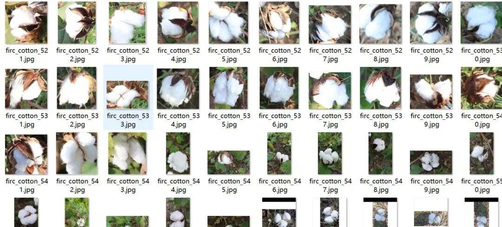
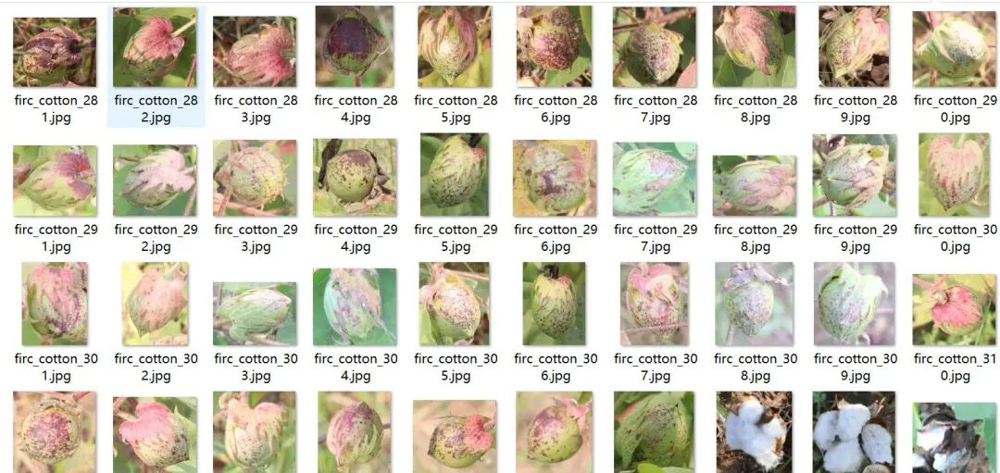
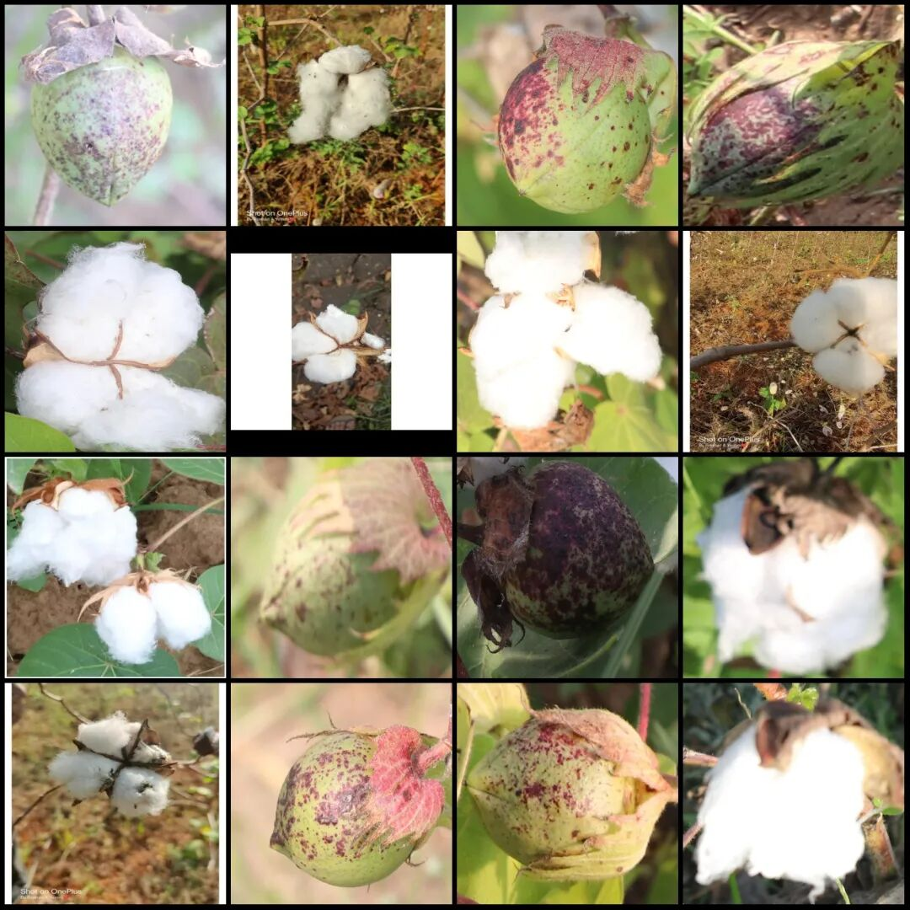
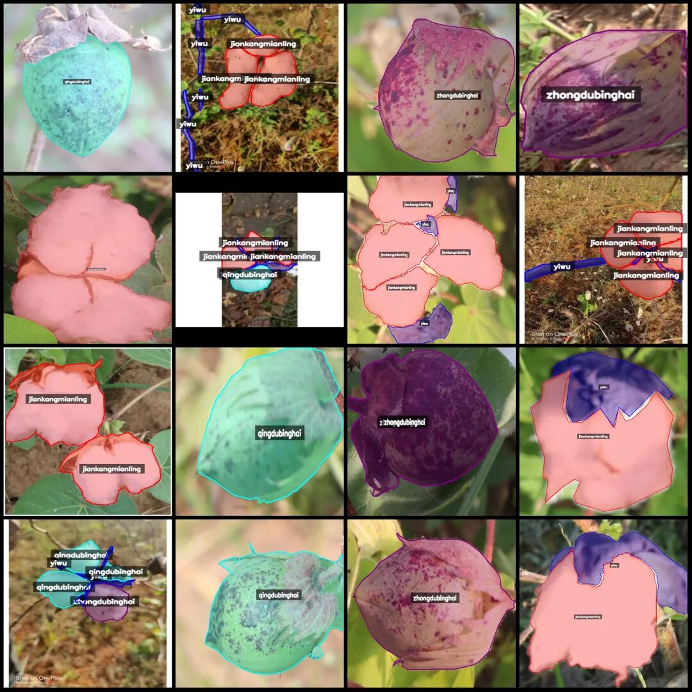
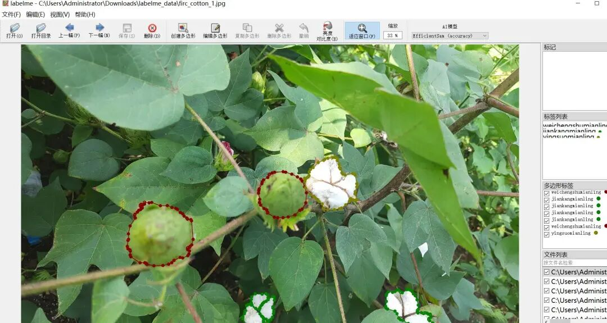

# Intelligent Agriculture Cotton Boll Disease Maturity Identification and Segmentation Dataset - LabelMe format: 969 images, 6 categories

Dataset format: labelme format (without mask files, only including jpg images and corresponding json files)

Number of images (number of jpg files): 969

Number of annotations (number of json files): 969

Label count: 6

Annotation category names: ["jiankangmianling", "qingdubinghai", "weichengshumianling", "yingsuomianling", "yiwu", "zhongdubinghai"]

["Foreign Object", "Hard Lock Cotton Seed", "Unripe Cotton Seed", "Mild Disease", "Severe Disease", "Healthy Cotton Seed"]

Number of boxes labeled in each category:

jiankangmianling count = 1513

qingdubinghai count = 360

weichengshumianling count = 10

yingsuomianling count = 51

yiwu count = 1158

zhongdubinghai count = 365

Total frame count: 3457

Using labeling tool: labelme=5.5.0

Image resolution: Multi-resolution images, such as 400x500, 1154x1003, etc.

Annotation rules: Draw polygons around the categories.

Important Notice: The dataset can be opened and edited using LabelMe. For JSON datasets, one must convert them into mask or Yolo formats for semantic segmentation or instance segmentation.

Special : This dataset does not guarantee the accuracy of the trained models or weight files.

Image Preview:

Annotation example:

Original image (pick 16 randomly):

Annotation:

LabelMe editing example:

## Payment

Here is a pay link on Stripe ( https://buy.stripe.com/3cs8yP7sY87d0vu9AB ). Please contact me lonlonago@foxmail.com after funding $89, and I will send you a complete data files , thank you!

